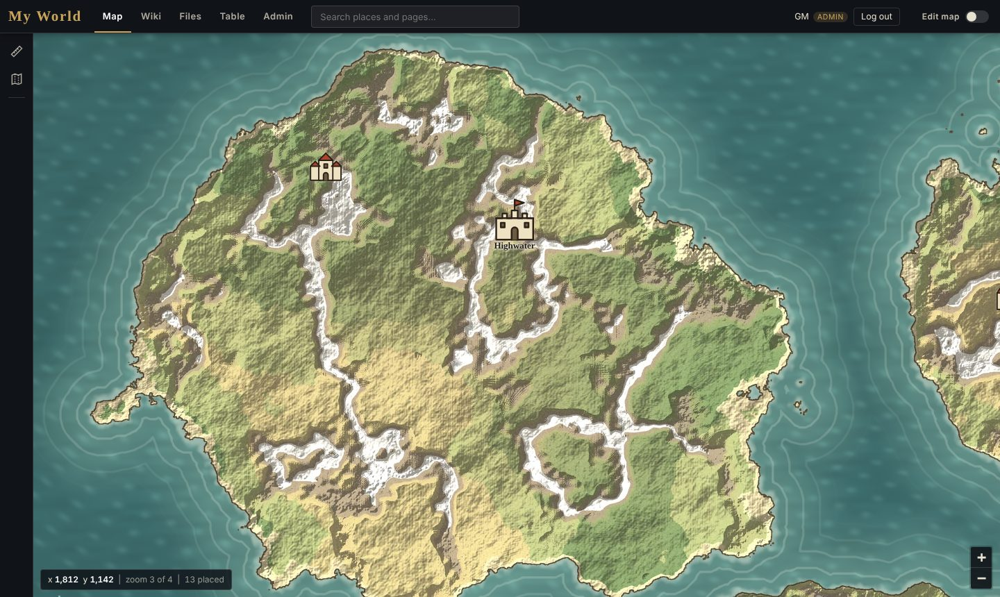
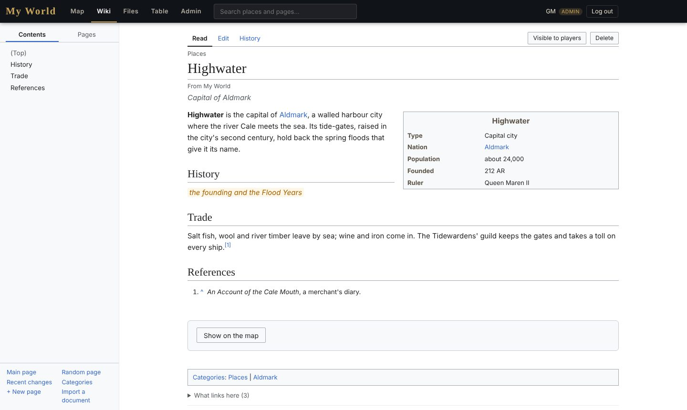
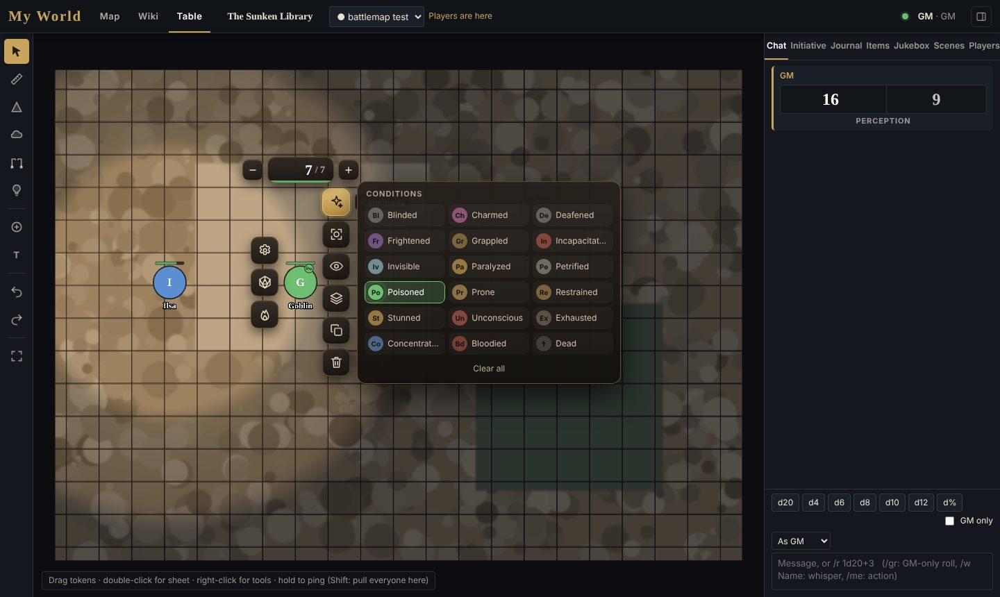
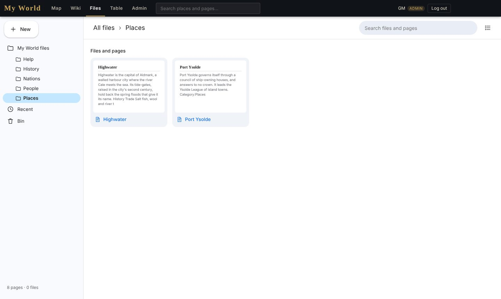
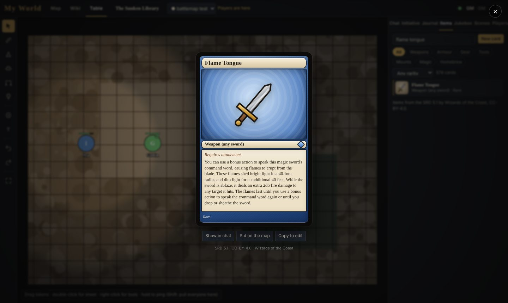

# Valanar Table

**A free, self-hosted home for your tabletop world: a zoomable world map, a Wikipedia-style wiki, a file drive and a
full virtual tabletop, all in one site you run yourself.** No subscriptions, no one-off licence fee, no account with
anyone. A free alternative to Roll20 Pro and Foundry VTT, built for campaigns with a world behind them.



It started as the site for one homebrew world (Valanar) and is released so anyone can build their own.

**New here? Start with [Getting started with your own world](docs/GETTING-STARTED.md).**

## What's in it

**The world map**
- Your own map, as big as you like (tested with 28,000 × 16,000 px), cut into tiles so it opens instantly at any zoom.
- Places with icons, names and details; nations, borders and a political view; an animated sea under a transparent coastline.
- A ruler with travel times on foot, horseback, cart and ship, along straight lines or smooth routes.
- Sea lanes, roads and trade routes (plot a voyage and it steers round the land), and curved names for oceans, seas, bays,
  lakes, rivers, mountain ranges, forests and regions.
- Lettering per place or as a preset per type: italic, bold, small caps, spacing, halo, ink, and names curved on an arc.
- Select several places with Ctrl+click and edit them together (Unity-style `[...]` for mixed values); copy, cut, paste
  and duplicate places.
- Map settings for the sea's colours and movement, rivers, lettering, icon size, night, the starting view and units.
- Party tokens on the world map; drag them and the ruler shows the journey.
- A calendar and clock for your world (your own months and year names): night falls on the map, dawn and dusk glow,
  and the weather moves over it (clouds, fog, rain, storms, snow), on battle maps too. The GM paints the weather onto
  the world map (rain here, snow in the mountains, fog on the coast); each visitor can look at any hour or weather on
  their own screen, starting from the GM's. In the table, the campaign's clock and weather are the GM's for everyone.
- Rivers and lakes found by themselves from a transparent map, with their own animated water.
- Admins edit in the browser; every change saves to the server, with the last 30 versions kept.

**The wiki**
- Pages laid out like Wikipedia: contents column, infoboxes, references, categories, what links here, short descriptions.
- An editor with live preview, toolbar and picture uploads; full history with compare and restore.
- GM-only pages and GM-only paragraphs (removed by the server before players' browsers ever see them).
- Import Google Docs (by link, pictures included), Word and Markdown files, or a whole Obsidian vault as a zip. Export everything as Markdown.
- Folders that read as pages, automatic links between pages, hover cards, and a timeline slider of every dated event.
- The Library: your world's own books on shelves, from a catalogue table (shelf, title, author, date, about, a passage), readable chapter by chapter.
- The Observatory: your world's constellations on a turning star chart, drawn star by star in a constellation builder
  (trace a picture underneath, link each to its wiki page, save any as a PNG).

**Files**
- A Google Drive-style browser: folders holding wiki pages and files together, grid and list views, drag-and-drop upload
  and moving, previews for pictures, PDFs, sound and video, a bin, and GM-only items.

**The table** (virtual tabletop)
- Battle maps with grid set-up, tokens, rulers, area templates, fog of war, pings.
- Dynamic lighting: walls, doors (locked and secret), windows, one-way walls, house walls (block light and hide what's behind them), coloured animated lights,
  token sight and darkvision, with the server hiding whatever players can't see.
- Character sheets: the Roll20 D&D 5e Community and Legacy sheets (switch between them, the character comes along), and a
  2D6 system sheet. Sheet rolls, roll templates and sheet workers run as on Roll20.
- Dice and chat with whispers, GM rolls and inline rolls; an initiative tracker.
- **Spell cards** for the 319 SRD spells (bring in more from your own books, or write homebrew); drag onto a character to
  add to their sheet.
- **Item cards** for every SRD 5e item (weapons, armour, gear, magic items): click to show in chat, drag into inventories,
  drop on the map as loot; make your own cards.
- Tokens made from portraits automatically, round and framed; frame the face and pick a frame in the built-in token stamp.
- Speak as any character (the GM) or your own (players); the speaker's token shows beside their messages and rolls.
- A token ring of quick tools (HP, conditions, light, initiative, looks), bare sprites with scaling and pixel-art mode.
- A jukebox: music and ambience channels everyone hears in sync, playlists, presets and a soundboard.
- Journal of characters and handouts in folders, with per-player permissions; pop-out sheets.
- Import scenes (walls, lights, tokens) and D&D 5e actors from Foundry VTT exports.

| | |
|---|---|
|  |  |
|  |  |

## Try it

You need [Node.js](https://nodejs.org) 18 or newer. Nothing else to install.

```
git clone <this repository>
cd valanar-table
node server/server.js
```

(or double-click `start.bat` on Windows). Open **http://localhost:8642/**. The first time, an example world is set
up: a map, a few places and some wiki pages. On the computer running it you're the admin automatically; set yourself a
password in **Table › Players** so you can log in from anywhere else.

Everything the site keeps (accounts, campaigns, the map, wiki pages and their history, uploads) goes in the
`vtt-data` folder. Back that up, or use **Admin › Download a full backup**.

## Make it your world

1. **Your map:** export it as one large PNG (transparent sea optional) and run `python tools/make_tiles.py my_world.png`
   (or drag the PNG onto `make_tiles.bat` on Windows). See [docs/YOUR-WORLD.md](docs/YOUR-WORLD.md).
2. **Name it:** Admin › The site.
3. **Places:** switch Edit map on and place them, or import a spreadsheet as CSV.
4. **Pages:** write them, import your Google Docs, or upload your Obsidian vault as a zip.
5. **Players:** Table › Players › New player invite.

## Put it online

- **For a session from home:** `share.bat` gives a temporary public address (Cloudflare quick tunnel).
- **Always on:** a small Linux server (a few pounds/dollars a month) and one script:
  `sudo bash deploy/setup-ubuntu.sh` sets up Node, HTTPS (free certificate, free address if you have no domain),
  a firewall and automatic restarts. Or use Docker: `deploy/docker-compose.yml`.

Details in [docs/HOSTING.md](docs/HOSTING.md).

## Guides

- [Getting started](docs/GETTING-STARTED.md): from nothing to your own world with players, step by step.
- [User guide](docs/USER-GUIDE.md): the map, wiki, files, admin and every part of the table.
- [Your world](docs/YOUR-WORLD.md): your map, icons, places, scale and pages.
- [Hosting](docs/HOSTING.md): at home, on a server, with Docker; backups and updates.
- [Contributing](CONTRIBUTING.md): how the code is laid out.

## Licence

[GNU AGPL-3.0](LICENSE): use it, change it, host it for your group or for anyone, free. If you host a changed version
for other people, share your changes under the same licence. Bundled libraries, the Roll20 sheets and the SRD 5.1 item
text keep their own licences: see [THIRD-PARTY-NOTICES.md](THIRD-PARTY-NOTICES.md).

Not affiliated with Wizards of the Coast, Roll20 or Foundry Gaming. Dungeons & Dragons is a trademark of Wizards of the Coast.
